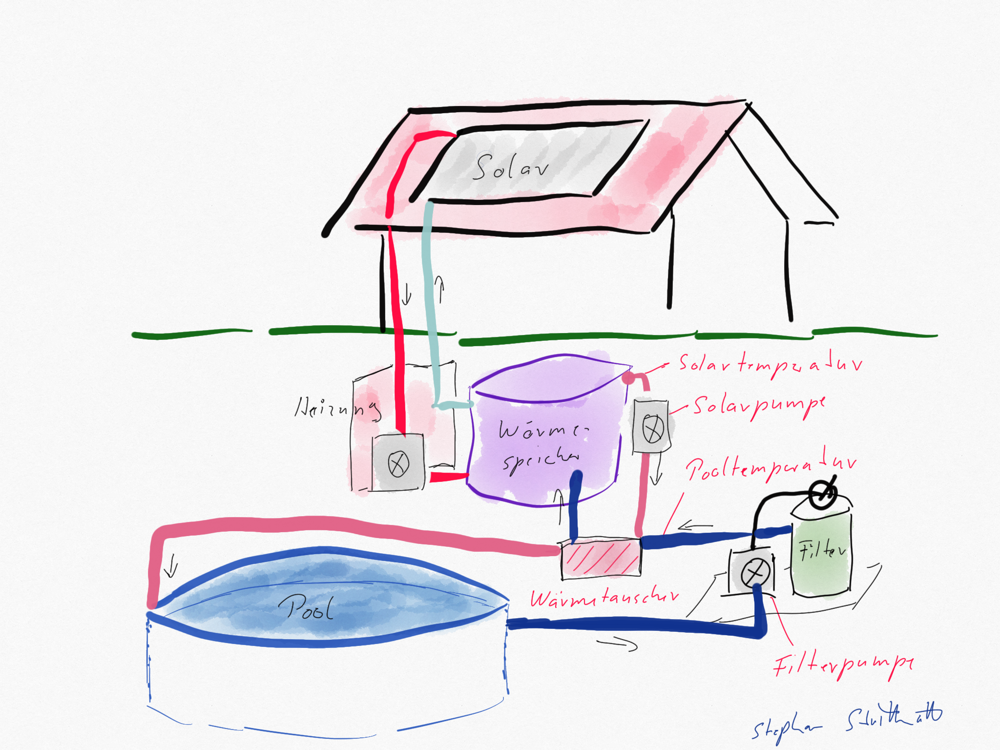

**🏊 Smart Swimming Pool: Home automation for smarter control of your swimming pool**



## Example Environment

In a typical setup, a thermal solar system heats water and supports the home heating system. The heated water is stored in a buffer tank, which has a third circulation loop for the pool. A pump attached to this loop circulates pool water through a heat exchanger:



## Basic Requirements

- Swimming pool with sand filter system
- Heating circuit with a pump-switchable heat exchanger
- Solar heat storage tank with an additional heating circuit for the pool

## Parts List (Bill of Materials)

| Component | Notes |
|---|---|
| ESP32 DevKit V1 | At least 4MB flash, USB cable included |
| DS18B20 temperature sensor (2x, waterproof) | Stainless steel probe, 1m cable |
| 2-Channel Relay Module (Dual relay) | Standard **active-low** module — see notes |
| 4.7kΩ resistors (2x) | Pull-up resistors for OneWire bus |
| Breadboard + jumper wires | For prototyping; use perfboard for permanent build |
| USB power supply (5V / 1A+) | For ESP32 + relay module |
| Enclosure (IP54+) | Optional but recommended for outdoor use |

Prices and the full parts list: see the [Bill of Materials](/docs/bom/) (controller electronics ~35–55 €, excluding pool pump and heat exchanger infrastructure).

> **⚠️ Relay module note:** The firmware drives relays **active-low** (GPIO **LOW** = relay ON, GPIO **HIGH** = relay OFF). This matches the vast majority of cheap 2-channel 5V relay modules. During ESP32 boot, GPIOs are briefly in high-impedance state — the firmware sets them HIGH (relay OFF) as soon as possible after startup. If your module behaves differently (active-high), see the [Troubleshooting](/docs/troubleshooting/) for configuration options.

## Hardware Assembly

### Breadboard Layout


*The ESP32 and relay module on a breadboard — the simplest way to get started.*

### Step 1: Prepare the ESP32

1. Connect the ESP32 to your computer via USB.
2. Verify it appears as a serial port (`/dev/ttyUSB0` on Linux, `COM3` on Windows).
3. Install **CP210x** or **CH340** drivers if needed ([CP210x drivers](https://www.silabs.com/developers/usb-to-uart-bridge-vcp-drivers), [CH340 drivers](https://www.wch.cn/download/CH341SER_EXE.html)).

### Step 2: Connect the Temperature Sensors

The DS18B20 sensors use the **OneWire protocol**. Connect them as follows:

The firmware (esp32dev environment) assigns **each sensor its own GPIO pin**:

| Sensor | ESP32 Pin | Wire Color (typical) |
|--------|-----------|---------------------|
| Solar collector (DS18B20 #1) | **GPIO32** | VDD=Red, GND=Black, DATA=Yellow/White |
| Pool water (DS18B20 #2) | **GPIO33** | VDD=Red, GND=Black, DATA=Yellow/White |

> **Important:** Connect a **4.7kΩ resistor** between **each** DATA line and 3.3V (pull-up). OneWire requires a separate pull-up per GPIO pin. For two sensors on separate GPIOs, you need **two 4.7kΩ resistors**.

### Step 3: Connect the Relay Module

| ESP32 Pin | Relay Module | Notes |
|-----------|-------------|-------|
| GPIO26 | Relay IN2 | Heating circuit pump |
| GPIO25 | Relay IN1 | Circulation/filter pump |
| 5V (VIN) | Relay VCC | **5V** not 3.3V! |
| GND | Relay GND | Common ground with ESP32 |

> **⚠️ Power:** The relay module requires **5V** power (use the ESP32's VIN pin when powered via USB). Do not power it from the 3.3V pin. Connect the ESP32 GND to the relay module GND (common ground).

### Step 4: Final Checks

Before connecting any pump or mains voltage, follow the **[Commissioning Checklist](/docs/checklist/)** — a complete step-by-step guide covering hardware check, firmware test, sensor verification, relay test, and automation check.

Key points before proceeding:
1. Double-check all connections against the schematic.
2. Verify the relay module: with the ESP32 powered and NOT yet controlling the relays, measure the GPIO pins with a multimeter — they should be HIGH (relay OFF). After toggling a relay in the web interface, the corresponding GPIO should go LOW (relay ON).
3. Flash the firmware first (see below) and test with the web interface **without** connecting pumps.
4. Still no 230V mains? Only connect pump/valve wiring after successful firmware tests.

## Firmware Installation

### PlatformIO (Recommended)

> ⚠️ **Important:** The pool-controller is a PlatformIO project. It does **not** have an Arduino IDE `.ino` file. PlatformIO is the only supported build method.

1. Install [Visual Studio Code](https://code.visualstudio.com/) and the [PlatformIO extension](https://platformio.org/install/ide?install=vscode).
2. Clone the repository:
   ```bash
   git clone https://github.com/smart-swimmingpool/pool-controller.git
   cd pool-controller
   ```
3. Open the folder in VS Code — PlatformIO will auto-detect the project.
4. **Select the correct environment:** The project has a default environment for the NORVI AE01-R industrial controller. For a standard ESP32 DevKit, switch to the `esp32dev` environment:
   - Click the **PlatformIO logo** in the VS Code footer bar (⚡ icon)
   - Go to **Project Tasks → esp32dev**
   - Or use the environment switcher at the bottom of the VS Code window
5. Connect the ESP32 via USB.
6. **Step A — Upload the firmware:** Click the **→ (Upload and Monitor)** button next to `esp32dev` in the PlatformIO footer bar. The firmware will compile and flash.
7. **Step B — Upload the filesystem (web interface):** The web UI is stored in a separate LittleFS partition and must be uploaded after the firmware:
   - In VS Code, open the PlatformIO tab → **esp32dev → Platform → Upload Filesystem Image**
   - Or run from the terminal:
     ```bash
     pio run -e esp32dev -t uploadfs
     ```
   - Without this step, the web interface will show a **missing assets** fallback page instead of the configuration UI.

### Verify the Flash

After flashing, open the serial monitor (115200 baud). You should see:

```
[INFO] Pool Controller v3.3.0 starting...
[INFO] WiFi: Starting in AP mode
[INFO] AP: 'Pool-Controller-Setup'. IP: 192.168.4.1
```

The ESP32 starts in **Access Point (AP) mode** by default.

## First Run & Configuration

### Step 1: Connect to the ESP32

1. Scan for WiFi networks — you'll see **`Pool-Controller-Setup`** (open network, no password).
2. Connect to it from your phone or laptop.
3. Open a browser and go to **<http://192.168.4.1>**

### Step 2: Configure WiFi

1. The web interface shows a configuration page.
2. Enter your home WiFi SSID and password.
3. Click **Save** — the ESP32 will reboot and connect to your network.

### Step 3: Set up MQTT

1. Find the ESP32's IP address on your router or from the serial monitor.
2. Open `http://<esp32-ip>/` in your browser.
3. Go to **Configuration → MQTT**.
4. Enter your MQTT broker address (e.g., `192.168.1.100` or `core-mosquitto`).
5. If using authentication, enter username/password.
6. Click **Save** — the controller will reconnect to MQTT.

> **No MQTT broker yet?** Install [Mosquitto](https://mosquitto.org/download/) on any machine on your network, or use the Mosquitto add-on in Home Assistant.

### Step 4: Home Assistant Integration

If you use Home Assistant with MQTT configured:

1. The controller automatically publishes MQTT discovery messages.
2. In Home Assistant, go to **Settings → Devices & Services**.
3. Click **Add Integration → MQTT** (if not already configured).
4. The pool controller should appear as a new device automatically.
5. All sensors, controls, and configuration parameters appear as entities — no manual setup needed.

> ▶️ **Detailed guide**: See the [Home Assistant Integration Guide](/docs/integrations/home-assistant/) for the complete entity reference, dashboard setup, automation examples, and troubleshooting.

### Step 5: Connect the Pumps

Only now — after verifying everything works:
1. **Disconnect** the ESP32 from USB power.
2. Wire the relay outputs to your pump contactors/valves.
3. Use appropriate cable cross-sections for 230V wiring.
4. Connect mains power through an **RCD (FI-Schutzschalter)**.
5. Power the ESP32 via its USB supply (keep it isolated from mains).



## What's Next?

Once your Pool Controller is running:
- Explore the **[Home Assistant Integration Guide](/docs/integrations/home-assistant/)** for the complete entity reference, dashboard setup, and automation examples
- Set up the **[Grafana Dashboard](/docs/components/grafana-dashboard/)** to visualize temperature trends
- Add the **[Pool Monitor](/docs/components/pool-monitor/)** for a dedicated display
- Check the **[Troubleshooting](/docs/troubleshooting/)** if you run into issues
- Follow the **[openHAB Integration Guide](/docs/integrations/openhab/)** to set up openHAB step by step
- Reference the **[openHAB Configuration](/docs/integrations/openhab-configuration/)** for the complete openHAB config files
